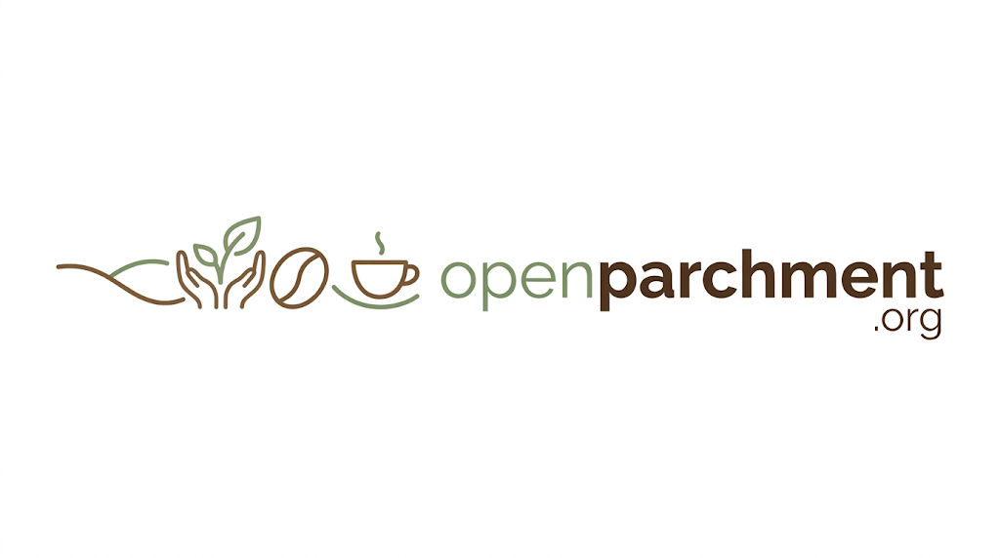

<p align="center">
  
</p>

<p align="center"><b>Every coffee has a story.</b><br>Open Parchment is the producer context layer for coffee: an open standard that turns coffee's story into data that travels with it, from the producer's hands to your cup.</p>

---

**Open Parchment** is the producer context layer for coffee: an open standard that turns coffee's story into data that travels with it, from the producer's hands to your cup. It's a free, non-profit standard that helps producers own their record, share what makes their coffee special, and get paid fairly. One shared format means buyers, and the AI agents working for them, can find it.

> **Status: technical sketch, not a standard.** Open Parchment is an early idea. The schemas here are working sketches to make the idea concrete and to invite critique. Expect everything to change, starting with feedback from producers, importers and roasters. The human-friendly version is at [openparchment.org](https://openparchment.org).

## Why

Every coffee app, roaster shop, cupping tool and marketplace invents its own way to describe a coffee. The result:

- **Producers disappear.** A farmer's name, lot and story often drop out between the exporter and the bag. Reputation builds up under a roaster's brand instead of the farm's.
- **Coffee data does not travel.** A bag tracked in one app cannot be found, rested or rated in another. Every new app re-scrapes the same product pages.
- **Flavor belongs to whoever owns the wheel.** Useful vocabularies exist, but each carries one institution's point of view, and none is a data format.
- **Agents guess.** "Find me a washed Ethiopian landrace that will peak next week" or "decaf that tastes like vanilla cake" only works if *decaf*, *washed*, *landrace* and *peak* are structured facts, not words buried in marketing copy.

The name comes from **parchment**, the protective layer around the coffee seed and the stage where a farmer's coffee is dried, stored and first sold. Parchment was also what people wrote lasting records on. Open Parchment starts where the farmer's work does.

## Principles

1. **Producers first.** Producers are first-class, persistent entities. They can author their own records, and they control the visibility of anything sensitive, such as plot boundaries, contact details and self-described ownership. Nothing about producers without producers.
2. **Neutral.** No company, association or research institution owns Open Parchment. Vocabularies plug in; none is privileged.
3. **Provenance on every claim.** Every record says who asserted it, in what role, and when. Tastings are claims, not facts, and many claims about one coffee is useful data.
4. **Thin core, open extensions.** The required fields stay small. Everything else is optional or an extension.
5. **Build on what exists.** Reuse established standards wherever they fit rather than reinventing them.
6. **Open forever.** Spec under CC BY 4.0, code under Apache 2.0.

## How it is layered

**Together these layers make Open Parchment the producer context layer for coffee.** The standard defines the shape of a producer's context, the registry is the system of record that resolves who's who, and an open protocol over MCP is how apps and agents reach it.

| Layer | What it is | Status |
|---|---|---|
| **Standard: data model** | The entities and fields: Producer, Farm, Harvest, Lot, Roast, Tasting, IdentityLink. | `schema/v0.2/` (JSON Schema 2020-12) |
| **Standard: semantics** | What terms mean in English, Spanish and Portuguese, and how vocabularies map to each other (SCA, WCR, roaster words, drinker words). | `vocabulary/` |
| **Registry** | The system of record: issues permanent ids, stores records, resolves identities, handles claims. Producers can use it over WhatsApp. Run by the non-profit, like ORCID for researchers. | Planned |
| **Context layer** | Resolved identity, shared meaning, provenance and timing, assembled into answers apps and agents can use, such as "this lot is María's, from her rainy 2026 season, and peaks in 4 days." | Planned |
| **Protocol** | The verbs agents use to reach the context layer: find lots, resolve a producer, get a lot's full context, link identifiers, claim a record. | Planned: open API and MCP server |

## The entities

```
Producer ──operates──▶ Farm
   │
   ├──tells──▶ Harvest (the season's story)
   │              ▲
   │              │ harvestRecord
   └──produces──▶ Lot ──roasted as──▶ Roast ──tasted in──▶ Tasting
                   ▲  ▲                    │
     blendOf ──────┘  │          batches (roast date ▶ rest window)
  (community lots)    │
                IdentityLink: ICO mark = importer code = roaster SKU
```

- **Producer**: a person, family, estate, cooperative or washing station. Carries alternate names and third-party ids for identity resolution, and an optional, producer-controlled `selfDescribed` block (for example woman-owned or smallholder).
- **Harvest**: the producer's season, written once and linked from every lot: narrative in their own language, structured conditions (heavy rain, late flowering, drying problems, an exceptional year), and photos or voice notes.
- **Lot**: the core unit of specialty coffee. Origin, elevation, varieties (WCR names, Wikidata ids), harvest, a structured **process** (including fermentation and co-ferment disclosure), a structured **decaf** fact and method, optional quality scores under any protocol, and optional **price transparency** by supply-chain stage.
- **Roast**: a roaster's product. Roast level, intended use, roaster notes, and a **rest window** (min, peak start, peak end) tied to batch roast dates.
- **Tasting**: one sensory record with brew details, descriptors from any vocabulary, comparable 0 to 1 attributes, and a rating with its scale.
- **IdentityLink**: a claim that two codes refer to the same coffee (or that one came from the other), recorded by whoever held both at a handoff, marked `confirmed` or `probable`.

Every Producer, Harvest and Lot carries a **registration** block: who created it and whether its subject has claimed it. A washing station can register its member farmers, but each farmer owns their id and can claim it later. See [ID-POLICY.md](ID-POLICY.md).

Ids look like `op:producer:finca-ejemplo-huila` and are never reused. Each entity can also carry `thirdPartyIds` from other systems, so organizations can match records without giving up their own ids.

## Standing on shoulders

| Source | How Open Parchment uses it |
|---|---|
| [Global Coffee Data Standard](https://datastandard.globalcoffeeplatform.org/) (Global Coffee Platform, CC BY 4.0) | Farmer, farm and plot identity, and the `thirdPartyIds` pattern. Open Parchment aims to be compatible, not competing. |
| [World Coffee Research Varieties Catalog](https://varieties.worldcoffeeresearch.org/) | Canonical variety names (`wcrName`). |
| WCR Sensory Lexicon and SCA Flavor Wheel | Mapped vocabularies. Referenced by term name, not reproduced. |
| [GS1 EPCIS 2.0 / CBV](https://www.gs1.org/standards/epcis) | Model for lifecycle events (harvested, roasted, bagged, opened) in a future version. GTINs supported on batches. |
| [schema.org](https://schema.org/Product) Product and Offer | Publishing roasts on the web in JSON-LD. |
| ISO 3166, ISO 4217, BCP 47, GeoJSON, Wikidata | Places, currencies, languages, plot shapes and neutral crosswalk ids. |
| [Transparency Pledge](https://www.transparencypledge.org/) | The model for optional price disclosure. |

## Repository layout

```
schema/v0.2/        Sketch 2: common, producer, harvest, lot, roast, tasting, identity-link
schema/v0.1/        Sketch 1, kept for reference
examples/v0.2/      Fictional, valid records: a self-registered producer, an unclaimed Kenyan
                    smallholder registered by a washing station, a harvest story, lots
                    (including a decaf community lot), a roast, a tasting, identity links
vocabulary/         Process vocabulary and flavor crosswalk (en / es / pt)
tools/validate.py   Validates every example against its schema version
QUESTIONS.md        The 15 questions the standard must answer
ID-POLICY.md        Who can create ids, how claiming works, who owns what
GOVERNANCE.md       How decisions and versions are made
CHANGELOG.md        What changed
assets/             Logo
```

All examples are fictional. To check them: `pip install jsonschema referencing && python3 tools/validate.py`

## The questions it answers

Every core field exists to answer one of [15 questions](QUESTIONS.md) from producers, cooperatives, importers, roasters, drinkers and agents. A few:

- How do buyers find me and credit me by name, no matter how many hands my coffee passes through?
- Which farm did this ICO-marked lot come from, and who says so?
- Which decaf coffees taste like vanilla cake, and how were they decaffeinated?
- What in my cabinet will be at its peak this weekend?
- How much was the farmer paid, at what stage, and who is making that claim?

## Roadmap

- **v0.1**: core entities, examples, starter vocabulary.
- **v0.2** (now): Harvest, registration and claiming, identity links, multilingual text and media, process vocabulary, ID policy and governance.
- **v0.3**: JSON-LD context and schema.org mapping; expanded flavor crosswalk; Spanish and Portuguese field documentation.
- **v0.4**: reference registry with WhatsApp registration and claiming; open API and MCP server for agents; lifecycle events aligned with EPCIS.
- **Pilot**: one cooperative or washing station registering its producers, and one roaster putting those producers on its bags.
- **Reference implementations**: [Beangraph](https://beangraph.com) reads and writes Open Parchment. More welcome.

## Get involved

Open an issue, propose a field, or tell us where this is wrong. We especially want to hear from **producers, cooperatives and importers**, and from anyone building a coffee app who is tired of inventing their own schema.

Site: [openparchment.org](https://openparchment.org)

## License

Specification and schemas: [CC BY 4.0](https://creativecommons.org/licenses/by/4.0/). Code: [Apache 2.0](https://www.apache.org/licenses/LICENSE-2.0). See [LICENSE.md](LICENSE.md).
